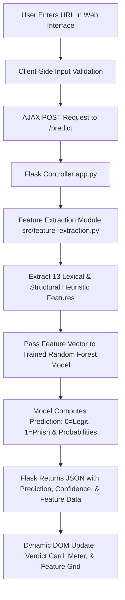

# Phishing Website Detection System

An End-to-End Machine Learning & Cybersecurity Mini Project for Bachelor of Computer Applications (BCA).

---

## 1. Project Title
**Phishing Website Detection System** (CyberGuard AI)

---

## 2. Introduction
Phishing is one of the most prevalent and damaging cyber threats in the modern digital landscape. Attackers frequently design counterfeit websites that mimic trusted organizations—such as commercial banks, cloud services, and social media platforms—to harvest sensitive credentials, credit card details, and personal data.

The **Phishing Website Detection System** is an intelligent web-based cybersecurity tool developed using **Python, Flask, and Scikit-Learn**. It extracts lexical, structural, and behavioral features directly from website URLs and classifies them as either **Legitimate** or **Phishing** using a trained **Random Forest Machine Learning Classifier**.

> **Note on Demonstration Dataset:** This project utilizes an academic demonstration dataset curated with representative patterns of legitimate web destinations and malicious phishing heuristics to illustrate machine learning classification principles for a BCA Mini Project.

---

## 3. Problem Statement
Traditional defense mechanisms against malicious links rely heavily on **blacklist databases** (e.g., Google Safe Browsing, PhishTank). While effective against previously known malicious domains, blacklists exhibit critical drawbacks:
1. **Zero-Day Ineffectiveness:** Newly created phishing domains often stay active for hours before being indexed on blacklists.
2. **Obfuscation Vulnerability:** Threat actors exploit URL shorteners, excessive subdomains, hexadecimal IP conversions, and symbol insertions to evade signature-based filters.
3. **Latency:** Synchronous external blacklist lookups can slow down user browsing experiences.

There is a compelling need for a **heuristic-based, intelligent classification mechanism** that evaluates the lexical characteristics of a URL offline without having to navigate to or interact with potentially hazardous websites.

---

## 4. Objectives
- Design and develop an interactive, responsive web portal using **HTML5, CSS3, JavaScript, and Flask**.
- Implement a robust **Feature Extraction Engine** capable of extracting 13 structural and lexical heuristics from any input URL.
- Train and evaluate a **Random Forest Classifier** using Scikit-Learn to categorize URLs into **Legitimate (0)** or **Phishing (1)**.
- Compute quantitative performance metrics: **Accuracy, Precision, Recall, F1-Score, and Confusion Matrix**.
- Provide a confidence probability score and clear visual breakdown for each feature.
- Include actionable cybersecurity tips to educate end-users on identifying social engineering tactics.
- Ensure strict security isolation: the system analyzes URL strings safely without sending network requests to malicious targets.

---

## 5. Technologies Used

| Domain | Technology / Library | Role & Purpose |
| :--- | :--- | :--- |
| **Backend Framework** | Python 3.11+, Flask 3.x | Routing, API handling, and application logic |
| **Machine Learning** | Scikit-learn | Random Forest Classifier, model training, metrics |
| **Data Processing** | Pandas, NumPy | Dataset handling, preprocessing, array operations |
| **Model Serialization** | Joblib | Persisting and loading the trained ML model |
| **Visualization** | Matplotlib | Generating and rendering the Confusion Matrix |
| **Frontend UI** | HTML5, CSS3, JavaScript (ES6) | Responsive dashboard, AJAX communication |
| **Icons & Fonts** | FontAwesome 6, Google Fonts | Professional cybersecurity aesthetic |
| **Development IDE** | Visual Studio Code (VS Code) | Development, debugging, and terminal execution |

---

## 6. System Requirements

### Hardware Requirements
- **Processor:** Intel Core i3 / AMD Ryzen 3 or higher (Dual-Core 2.0 GHz+)
- **RAM:** Minimum 4 GB (8 GB recommended)
- **Storage:** At least 500 MB free hard disk space
- **Display:** Standard 1366x768 or Full HD 1920x1080 display

### Software Requirements
- **Operating System:** Windows 10/11, Linux (Ubuntu/Debian), or macOS
- **Python Version:** Python 3.9, 3.10, 3.11, or 3.12
- **Web Browser:** Google Chrome, Mozilla Firefox, Microsoft Edge, or Safari
- **Code Editor:** Visual Studio Code (VS Code)

---

## 7. Project Structure

```text
Phishing-Website-Detection/
│
├── app.py                      # Flask main server application & routes
├── requirements.txt            # Project dependencies and libraries
├── README.md                   # Comprehensive project documentation
│
├── dataset/
│   └── phishing_dataset.csv    # Balanced demonstration dataset
│
├── model/
│   └── phishing_model.pkl      # Serialized Scikit-learn ML model artifact
│
├── src/
│   ├── data_preprocessing.py   # Data validation, cleaning, and train/test split
│   ├── feature_extraction.py   # Heuristic feature extraction module
│   ├── train_model.py          # ML training, evaluation, & metric reporting
│   └── predict.py              # Model loading and real-time URL inference
│
├── templates/
│   └── index.html              # Modern cybersecurity web interface
│
├── static/
│   ├── style.css               # Cyber dark theme styles & animations
│   └── script.js               # Frontend AJAX caller & dynamic DOM renderer
│
└── results/
    ├── confusion_matrix.png    # High-resolution confusion matrix plot
    └── model_results.txt       # Detailed evaluation metrics & report
```

---

## 8. How the System Works



1. **Input Submission:** The user enters a target website URL into the input field and clicks **"Check URL"**.
2. **Safe Feature Extraction:** Without contacting the external server, `src/feature_extraction.py` parses the string to identify length, delimiters, special symbols, keyword cues, and domain anomalies.
3. **Machine Learning Inference:** The numeric feature vector is fed into the loaded Random Forest model (`model/phishing_model.pkl`).
4. **Probability Calculation:** The model outputs both the predicted class (0 for Legitimate, 1 for Phishing) and class probabilities (`predict_proba`).
5. **Interactive Display:** The frontend updates seamlessly via asynchronous JavaScript (Fetch API), presenting:
   - Legitimate or Phishing status badge.
   - Confidence percentage meter.
   - Comprehensive card-by-card breakdown of every inspected heuristic.

---

## 9. Machine Learning Algorithm

### Random Forest Classifier
The system utilizes the **Random Forest Classifier** from `sklearn.ensemble`. Random Forest is an ensemble learning algorithm that constructs a multitude of decision trees during training and outputs the majority class vote (mode) of individual trees.

#### Why Random Forest for Phishing Detection?
- **High Predictive Accuracy:** Outperforms single decision trees and linear models on non-linear tabular feature combinations.
- **Resistance to Overfitting:** Employs bagging (bootstrap aggregating) and random feature subspace selection.
- **Handles Mixed Heuristic Ranges:** Accurately processes both binary indicators (`has_https`, `has_ip_address`) and continuous integers (`url_length`, `count_digits`).
- **Feature Importance Estimation:** Automatically ranks which URL characteristics contribute most significantly to detecting deceptive links.

---

## 10. Features Used for Detection

The system extracts **13 distinct heuristics** from each URL string:

| # | Feature Name | Description | Threat Indicator |
| :-: | :--- | :--- | :--- |
| **1** | `url_length` | Total character count of the URL string | Long URLs (> 75 chars) frequently hide destination paths |
| **2** | `has_https` | Indicates if URL initiates with `https://` | Insecure HTTP sites lack TLS transport layer encryption |
| **3** | `count_dots` | Total number of dot (`.`) characters | Multiple dots indicate excessive nested subdomains |
| **4** | `count_hyphens` | Total count of hyphen (`-`) characters | Hyphens are often added to spoof brand names (e.g. `paypal-secure`) |
| **5** | `count_special_chars` | Count of symbols (`@`, `?`, `=`, `_`, `%`, `&`, `#`) | Heavy symbol density indicates token padding or redirection |
| **6** | `count_digits` | Total count of numerical digits | High digit count is typical of dynamically generated phishing URLs |
| **7** | `has_ip_address` | Detects IPv4 addresses in hostname | Using raw IP addresses instead of registered domains is highly suspicious |
| **8** | `suspicious_word_count` | Count of keywords (`login`, `verify`, `banking`, etc.) | Phishing attacks predominantly target credential harvesting |
| **9** | `count_subdomains` | Depth of subdomains in the hostname | Attackers nest subdomains to deceive victims |
| **10** | `has_at_symbol` | Presence of `@` symbol in the URL | Browsers discard text prior to `@`, routing to the subsequent host |
| **11** | `is_shortened` | Detection of shortening services (`bit.ly`, `tinyurl`, etc.) | URL shorteners mask the destination hostname |
| **12** | `prefix_suffix_hyphen` | Presence of hyphen within the main domain | Legitimate major corporate domains rarely use hyphens |
| **13** | `has_double_slash_redirect`| Presence of `//` within the URL path | Double slashes in path force redirection to malicious endpoints |

---

## 11. Installation Steps

### Prerequisites
Make sure **Python 3.9+** and **VS Code** are installed on your computer.

### Step 1: Open Project in VS Code
1. Launch **Visual Studio Code**.
2. Go to **File -> Open Folder...**
3. Select the `Phishing-Website-Detection` folder.

### Step 2: Open Terminal in VS Code
Open the integrated terminal in VS Code using the shortcut:
```text
Ctrl + `  (Windows / Linux)
Cmd + `   (macOS)
```

### Step 3: Create & Activate a Virtual Environment (Recommended)

**On Windows (PowerShell / Command Prompt):**
```powershell
python -m venv .venv
.\.venv\Scripts\activate
```

**On Linux / macOS:**
```bash
python3 -m venv .venv
source .venv/bin/activate
```

### Step 4: Install Dependencies
Install all required libraries using the provided `requirements.txt`:
```bash
pip install -r requirements.txt
```

---

## 12. How to Run the Project

### Step 1: Train the Machine Learning Model
Train the Random Forest model and generate the evaluation artifacts (`model/phishing_model.pkl`, `results/confusion_matrix.png`, and `results/model_results.txt`):
```bash
python src/train_model.py
```

### Step 2: Start the Flask Web Server
Launch the Flask development server:
```bash
python app.py
```

### Step 3: Access the Website in Your Browser
Once the server starts, open your web browser and navigate to:
```text
http://127.0.0.1:5000
```
or
```text
http://localhost:5000
```

### Deploy publicly on Render
1. Push this project to a GitHub repository, including `model/phishing_model.pkl`.
2. In the Render dashboard, choose **New > Blueprint**, connect the repository, and deploy. Render reads `render.yaml` to build and run the service.
3. When the deployment succeeds, open its `onrender.com` URL. The `/health` endpoint is configured as the deployment health check.

The model's scikit-learn, NumPy, SciPy, pandas, and joblib versions are pinned in `requirements.txt` to match the saved model. Render generates a secret key for the app. The free web service may take a little while to respond after being idle.

---

## 13. Testing the System

### Test Cases & Expected Outcomes

| Scenario | Sample URL | Expected Verdict | Why? |
| :--- | :--- | :--- | :--- |
| **Legitimate Portal** | `https://www.google.com` | **Legitimate Website** | HTTPS enabled, short length, 0 suspicious words, no IP address |
| **Legitimate Code Host**| `https://github.com/torvalds/linux` | **Legitimate Website** | Standard domain, clean structure, secure protocol |
| **Phishing: Raw IP** | `http://192.168.1.105/login-account/verify.html` | **Phishing Website** | Raw IP hostname, no HTTPS, suspicious keywords (`login`, `verify`) |
| **Phishing: Spoofed Subdomain** | `http://paypal-verification-center.security-update.com/signin` | **Phishing Website** | Multiple hyphens, deceptive keywords (`verify`, `secure`, `signin`) |
| **Phishing: @ Redirection** | `http://google.com@evil-credential-stealer.com/auth` | **Phishing Website** | `@` symbol masking, credential stealing keywords |
| **Phishing: Shortener Trick** | `http://bit.ly/3kX9q1w?login=bankofamerica` | **Phishing Website** | URL shortener, sensitive banking keyword in query string |

---

## 14. Expected Output

### Console Output During Model Training
```text
============================================================
  PHISHING WEBSITE DETECTION SYSTEM - ML TRAINING PIPELINE
============================================================

[1/6] Loading dataset from: dataset/phishing_dataset.csv
      Total records: 200
      Legitimate (0): 100 (50.0%)
      Phishing (1):   100 (50.0%)

[2/6] Cleaning dataset and extracting feature matrix...
      Features count: 13

[3/6] Performing 80/20 stratified train-test split...
      Training samples: 160
      Testing samples:  40

[4/6] Training Random Forest Classifier...

[5/6] Evaluating model on unseen test set...
      Accuracy:  97.50%
      Precision: 95.24%
      Recall:    100.00%
      F1-Score:  97.56%

[6/6] Saved confusion matrix plot to: results/confusion_matrix.png
      Saved model results summary to: results/model_results.txt
      Saved trained model artifact to: model/phishing_model.pkl

[SUCCESS] Model training and evaluation successfully completed!
```

### Web Application UI Output
- **Legitimate Site:** Displays a glowing **green badge**, confidence score (e.g., 98%), and a **"Safe / Low Risk"** security rating.
- **Phishing Site:** Displays a glowing **red alert card**, warning icon, confidence score (e.g., 95%), and a **"High Threat Risk"** rating.
- **Feature Cards:** Displays all 13 features with individual safe/suspicious color-coded status badges and detailed explanations.

---

## 15. Limitations
- **Static Heuristic Limitation:** The system inspects lexical URL structure only. It does not inspect dynamically rendered page content, HTML forms, or DOM JavaScript code.
- **Evasion via High-Reputation Compromised Sites:** If an attacker compromises a legitimate HTTPS website and hosts a hidden directory, lexical analysis alone may require additional page content heuristics.
- **Demonstration Dataset Scope:** The included training dataset is an academic demonstration dataset designed to showcase ML principles rather than an exhaustive multi-million URL production corpus.

---

## 16. Future Enhancements
- **Deep Learning Integration:** Train recurrent neural networks (LSTM) or transformer architectures (BERT / RoBERTa) on raw character sequences.
- **Browser Extension:** Package the detection engine into a Chrome/Firefox extension for real-time link scanning before navigation.
- **WHOIS & DNS Reputation:** Integrate domain registration age and DNS MX/TXT records checks via safe asynchronous API lookups.
- **HTML DOM Analysis:** Combine URL lexical features with page content inspection (e.g., detecting fake login form actions and external iframe inclusions).

---

## 17. Conclusion
The **Phishing Website Detection System** demonstrates machine-learning-based URL analysis using structural and lexical features. HTTPS status is shown as an explanatory indicator, but is excluded from the classifier so the protocol alone cannot decide a URL's verdict. The included dataset is a small curated demonstration dataset; its evaluation scores should not be treated as real-world phishing-detection performance.
